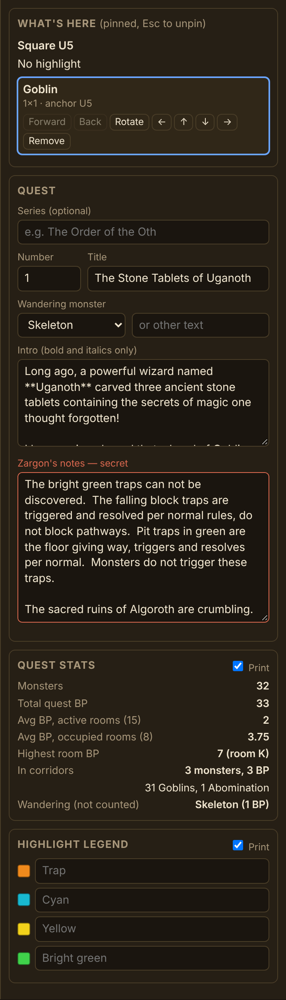

# Quest Map Generator

A browser-only editor for HeroQuest-style quest maps. The **whole quest lives in the link**: the
map, the pieces, the highlights, the quest number, title, intro, Zargon's secret notes and the
wandering monster. Nothing is saved and nothing is sent anywhere. Copy the address bar, send it to
someone, and they see exactly the same quest.

Because it's one static HTML file, it can be hosted anywhere (GitHub Pages, any web server, or just
opened from disk).

> **Status: first working version** on the standard 26 x 19 board with its 22 rooms. See
> [AGENTS.md](./AGENTS.md) for the decisions and plan and [docs/FORMAT.md](./docs/FORMAT.md) for the
> link format.


**[Open the quest from these screenshots in the live editor](https://vibecoder-1z3r0.github.io/the-quest-map-generator/#AZVWbY8jRxGesT2-dftl7L3bJR_QuXyK0MSxrRw6CQnBhzsCl0gBVslFKJAA7ZmamdaOu4funnWM9pfwT_mGqqft9cEGxEoru2eq6-Wpp55yOHvk7yYIgmDqD1H0Q4f3zILHD2EQnB1u_GFKz6PgJgwgmHqLiEz9IQrIdBo4-9bJ1D0-evOfN8EpWtQJHg43wdkh8IfTkXKp2Sz6xSz65WU_fNUPr6Ow6Tz7WT-8Hgyvw6d_6yTPesnTbvK0k1z3k6uL5KqXXHeTH_WSD6Log0E0G0SXl-GXg3A27o9m_dF4fMXi382ez2bJZJLEcTKNk9kkmcTJs3HyjM2vBiG7nA3GYRXPR3EymiajSTKOn4-nUe8yfDsLPxyHHw7DYjhaXfSKQRQNosGTaDjqBcMoGETBZcjjXvwkmvSj6cXzuPM87oZx_5tZGLLR8CeT8YLNO_G8G8-703ln-m04Xk4GyehJwi6SyTAZsiS--K43WbDBYsIWo-FiOF2weP50OI8n87g3n3bnk-582plPOvM4nA8v5vFg3h0t-uPkYppEk6Q_S56Mkw5LusOkN_rr1bD38vKPs-mfxpM_s-Ffxhd8EgZB-PLH70qEr6ySCO_4tkJrQOXwdcGlsuU_el8oWQAv1Ao41GqPOm8q2Iu_c52B5DvMYLn0xsslpFzfYQa21IjAZSpQWjDOufXOUyUtF1LIAmyJYDDVPuaOFyIFZ1uqpigt5EoXylqUC8Y-h5LfIWhMBVKMvdIUiFvgsOUyIw9v1bYS0qygwgy2BxcgR64rNAZMxQ-oYbn8otlh5fJdQckNoLSoXdYIhqf0VTdCupyWy9dVoXRbnZBgkOu0pDe2RINwh_pwLG3D2DeqgV1jLNyhtI1GENIq5_gIhvO8Ao1WUx3Aq8q9P-vAeQNWQKVptI2WZLcDq2CHVKGx9OAAObk4xdlraljJZWYWjL3BPde4gq0m7ErUCs2KYHW2pyqPNUKpqgwyLgvUBnKuodDILZI5l0d4gVdK4uKfMTFnqwV1qtCIEqzmtYGUS5DKwhYhEyZVd4TuBoDMKVlq_bZS6a235xrBalEUrgttvUZV1OQaNUild7wC3VSUe6Za3-5-zW255wezAbgR1rsT0mfj_FLMSikNhbijwHt-WB2jmfNg5izYBuC3ShpLJj6gv-Lb7iJtGHv3CGVOYFL8VDc7Aq3YMPYa1vCuFAZyoY113aBuekq5pmjkpqUNWLLUSu0gFzIzbSXu4vmwnlFlA_Al8qy9KPF7CzXXlprVZLCGF_sSJRxUA5bfItTKGDRGKOnJ7J2fD6uzzhFbhrpcTEmXCbYTsivY86pqsUxRuPbSWEllRYrkCFLN01sC4QVjb2AN3DjXqkZf56nwtCReC-uBQ0MIZTRRGu-QO-dc-puNlFi1WCEUWjUyg0ZmqCVyW8K-RM-Af3O_5wYSF1cY4F6CIFNKf8TYr2ANLz_5BAoaBarpRlmP0mc-gX0p0hL2oqqIPFZphFdQKWNhq7ID1ErIVtEyvuMFbhj7FNZtof-79W23OVi128JeEI-8dFRoLWpKQLUlb4XMWkAy4idJmIK6ITmwkGu1ayWtxCrfAHxdKwmZogtGPXR0iwUR1yrQ3NoKqTnOuVK3kHKDYCqRofnPBtBXDz4xALZYCk-M0-UNY7-GNTS1T7mVoFZy2xVwZPnDpD5kVIg78n3w3XpUWDyI5KzFkdfmow3Aa3k4Rntvmpw8a1VVwCFVuy23kIkUNwCf562g-pfmtmm1-eAm2VCNao_Zg9bWwjrsTZPnqOGnP9B-r3z_39AfC3QE3bkt0dLdrbwKeeYQojSOpgeK6aQA9ftzfCYSjP0G1vB7meJ5P9xqpZ6i14_MDXZd8RQBybd1COP3KdZuL8Nxi_rCvCRI0KRBrei8oHXoXOduNilgxYWmfI7XFy_c1TaSW5RbtROSu5nLRdFo4tD50mb3b27uX1vL09v7TzFHafD-qxpTwat7dg8_X6_X8PgHu4dX8PD_B0r3VEYmCAeE9hdQQz8rTKkF3rbC5iTuJRDhiC5UQuHXoT2bphJJU4TcwD1jb49IU_t2x4XiANnSgsowp-2aPcIQanLLETTvs-SBGM7oKGNO5kgyHnrtEvdy8t9Z4XTGjzI52TD2GayhPilf6Sf_41fw5oaxj4PgXw)** (it's the owner's quest #1; the whole quest is in that link).

More to try in the live editor: [a blank map](https://vibecoder-1z3r0.github.io/the-quest-map-generator/) to start your own, or [Quest 2, The Parchment of Oaths](https://vibecoder-1z3r0.github.io/the-quest-map-generator/#AeVSsU7EMAzlJKabmJi9sZxu4BNgATEcEsfA6CbuJbo0qRznKjHy5ThpewufQJWhseP3np-9ufm33-bx_ugI3pGNGygKpB4OKC7_3L4QJ8o7wF6IIY8UrY8nMKlECZQzuFQ4gyXjR0dcc6JQH5IiwRG7QJIr3OcJYxK3g1dweCGwPpt0ISYLCM5bSxEGHLUYpdLguZVh1GN81YQsvkcjcI5p0nBuRH8177fbhUMYjeLXZw06td9nFDRp6Br-GzdRk0qnlmUa0MeWq9cxTcR9CTD5b2S7tgHBEyipwpBVwq9UYChZ4KLBolA-LmxmZdtBSHqhFeJB9WtcnY1WWYU9XWYJ47WlxZfJi_NRaZ6KQEcTMu2g49qiW8bTJ17k53ksJVpCO_sQkk6lI0WarVNpofBZRbaa7NCmaW0509VxhyHkve7HXd2OA1vdgOqyuF8) (the start of the owner's second quest).

## Using it

1. Open the page (it starts as [a blank map](https://vibecoder-1z3r0.github.io/the-quest-map-generator/)). Choose a tool on the left, or pick a piece from the palette.
2. Click the board to place a piece. The address bar updates as you go, with no page reload.
3. Fill in the quest number, title, intro, notes and wandering monster on the right.
4. Copy the link (the **Copy link** button, or straight from the address bar) to share or bookmark
   the quest. Opening any link redraws the map.

### Board and pieces

- The board is the standard fixed board, with its rooms lettered A to V. Quests are made by placing
  pieces on it, not by drawing walls. Grey out the rooms a quest doesn't use.
- Pieces: doors, hidden doors, secret door tiles, wall tiles and double wall tiles, stairs, furniture, treasure chests, traps, monsters, heroes and
  numbered (1-9) and lettered (A-I) markers for pointing at things from your notes.
- Pieces can be **rotated** (`R`), **moved** (drag, arrow keys, or the buttons in the panel) and
  **removed** (`Del` or the Eraser). Several pieces can share a square. New pieces go on top, and
  the panel's *Bring forward* and *Send back* change the order.
- Doors are placed in a square and rotated onto the edge they sit on.
- Hover a square to see everything in it in the **What's here** panel (squares are labeled like
  `E8`). Click to pin the panel.

### Live quest sheet

Below the map and its legend, the quest is shown rendered (title, wandering monster, introduction
and Zargon's notes with their formatting), and it updates as you type in the Quest panel. It isn't
printed; the print page has its own layout.

### Room tiles

To merge rooms (as with a physical room tile laid over them), choose **Room tile** under *Room tiles*
and drag out a rectangle on the board. Tiles can be any size, are always rectangles, and sit
**under every piece**. Select a tile to move it (drag or arrow keys), or use the *What's here*
panel to change its width and height, reorder it among other tiles, or remove it.

### Quest stats

A **Quest stats** card (and the print page) summarises the quest, recalculated as you edit:
monsters on the map, total quest BP, the average BP per *active* room (a room with no grey square)
and per room that has monsters, the highest room, monsters in corridors (counted in the totals only),
and a breakdown by type. The wandering monster is shown separately and never counted. Rooms are
lettered A to V on the board. BP comes from each monster's body points in `src/catalog.json`. The Dread Warlock's body points vary
by quest, so it counts as a monster but its BP is left out, and the card says so.

### Highlights

Paint squares with a highlight color: grey for solid stone, orange for traps (of any kind), cyan,
yellow or bright green. Highlights tint whatever is underneath. Grey is always labeled "Solid stone"
and orange "Trap". Name the other colors in the legend editor ("cyan = secret room"); each used
color is listed beside the map.

### Quest text

- **Series** (optional, for example "The Order of the Oth"), **quest number** and **title**: plain
  text. The series shows above the title on the quest sheet and the print page.
- **Intro**: text for the heroes, with **bold** and *italics* only.
- **Zargon's notes**: your secret notes, with headings, bullet and numbered lists, bold, italics,
  rules and tables.
- **Wandering monster**: pick a monster, type something else, or leave both blank for none.
- A single new line is a line break. Extra blank lines add extra space.
- Only a small, safe set of characters is accepted. Anything else is removed.

### Undo, theme and printing

- **Undo / Redo** buttons (`Ctrl+Z` / `Ctrl+Y`) step through your edits. The browser's back and
  forward buttons work too.
- The editor opens in **light mode**. Switch to **dark mode** (or any later theme) for easier editing. The choice is
  stored in the link, so a shared link opens in the theme it was saved with. Printing never uses a dark
  theme: light themes print as themselves, and dark ones print in light.
- **Print** gives a one-page portrait sheet in the order of the official books: the map, the
  quest title, the introduction, Zargon's notes (if any), the wandering monster, then a compact key
  of the pieces and small quest statistics. Tick or untick **Print** next to a section's title to
  include or leave it out; **Monsters only** trims the key to the monsters. These choices are not
  stored in the link.

### Heads up

- **Anyone with the link can read Zargon's secret notes**, because they are stored in the link.
  Only share a link with players if you are happy for them to see everything in it.
- Very long links may be cut off by some chat apps. A warning appears above about 2,000 characters.
- Needs a recent browser (about Chrome 103, Safari 16.4 or Firefox 113). Older browsers show a
  message with the minimum versions.

## Screenshots

These are generated by script (`make screenshots`) from the real editor, so they always match what
the tool does. They show [quest #1 in the live editor](https://vibecoder-1z3r0.github.io/the-quest-map-generator/#AZVWbY8jRxGesT2-dftl7L3bJR_QuXyK0MSxrRw6CQnBhzsCl0gBVslFKJAA7ZmamdaOu4funnWM9pfwT_mGqqft9cEGxEoru2eq6-Wpp55yOHvk7yYIgmDqD1H0Q4f3zILHD2EQnB1u_GFKz6PgJgwgmHqLiEz9IQrIdBo4-9bJ1D0-evOfN8EpWtQJHg43wdkh8IfTkXKp2Sz6xSz65WU_fNUPr6Ow6Tz7WT-8Hgyvw6d_6yTPesnTbvK0k1z3k6uL5KqXXHeTH_WSD6Log0E0G0SXl-GXg3A27o9m_dF4fMXi382ez2bJZJLEcTKNk9kkmcTJs3HyjM2vBiG7nA3GYRXPR3EymiajSTKOn4-nUe8yfDsLPxyHHw7DYjhaXfSKQRQNosGTaDjqBcMoGETBZcjjXvwkmvSj6cXzuPM87oZx_5tZGLLR8CeT8YLNO_G8G8-703ln-m04Xk4GyehJwi6SyTAZsiS--K43WbDBYsIWo-FiOF2weP50OI8n87g3n3bnk-582plPOvM4nA8v5vFg3h0t-uPkYppEk6Q_S56Mkw5LusOkN_rr1bD38vKPs-mfxpM_s-Ffxhd8EgZB-PLH70qEr6ySCO_4tkJrQOXwdcGlsuU_el8oWQAv1Ao41GqPOm8q2Iu_c52B5DvMYLn0xsslpFzfYQa21IjAZSpQWjDOufXOUyUtF1LIAmyJYDDVPuaOFyIFZ1uqpigt5EoXylqUC8Y-h5LfIWhMBVKMvdIUiFvgsOUyIw9v1bYS0qygwgy2BxcgR64rNAZMxQ-oYbn8otlh5fJdQckNoLSoXdYIhqf0VTdCupyWy9dVoXRbnZBgkOu0pDe2RINwh_pwLG3D2DeqgV1jLNyhtI1GENIq5_gIhvO8Ao1WUx3Aq8q9P-vAeQNWQKVptI2WZLcDq2CHVKGx9OAAObk4xdlraljJZWYWjL3BPde4gq0m7ErUCs2KYHW2pyqPNUKpqgwyLgvUBnKuodDILZI5l0d4gVdK4uKfMTFnqwV1qtCIEqzmtYGUS5DKwhYhEyZVd4TuBoDMKVlq_bZS6a235xrBalEUrgttvUZV1OQaNUild7wC3VSUe6Za3-5-zW255wezAbgR1rsT0mfj_FLMSikNhbijwHt-WB2jmfNg5izYBuC3ShpLJj6gv-Lb7iJtGHv3CGVOYFL8VDc7Aq3YMPYa1vCuFAZyoY113aBuekq5pmjkpqUNWLLUSu0gFzIzbSXu4vmwnlFlA_Al8qy9KPF7CzXXlprVZLCGF_sSJRxUA5bfItTKGDRGKOnJ7J2fD6uzzhFbhrpcTEmXCbYTsivY86pqsUxRuPbSWEllRYrkCFLN01sC4QVjb2AN3DjXqkZf56nwtCReC-uBQ0MIZTRRGu-QO-dc-puNlFi1WCEUWjUyg0ZmqCVyW8K-RM-Af3O_5wYSF1cY4F6CIFNKf8TYr2ANLz_5BAoaBarpRlmP0mc-gX0p0hL2oqqIPFZphFdQKWNhq7ID1ErIVtEyvuMFbhj7FNZtof-79W23OVi128JeEI-8dFRoLWpKQLUlb4XMWkAy4idJmIK6ITmwkGu1ayWtxCrfAHxdKwmZogtGPXR0iwUR1yrQ3NoKqTnOuVK3kHKDYCqRofnPBtBXDz4xALZYCk-M0-UNY7-GNTS1T7mVoFZy2xVwZPnDpD5kVIg78n3w3XpUWDyI5KzFkdfmow3Aa3k4Rntvmpw8a1VVwCFVuy23kIkUNwCf562g-pfmtmm1-eAm2VCNao_Zg9bWwjrsTZPnqOGnP9B-r3z_39AfC3QE3bkt0dLdrbwKeeYQojSOpgeK6aQA9ftzfCYSjP0G1vB7meJ5P9xqpZ6i14_MDXZd8RQBybd1COP3KdZuL8Nxi_rCvCRI0KRBrei8oHXoXOduNilgxYWmfI7XFy_c1TaSW5RbtROSu5nLRdFo4tD50mb3b27uX1vL09v7TzFHafD-qxpTwat7dg8_X6_X8PgHu4dX8PD_B0r3VEYmCAeE9hdQQz8rTKkF3rbC5iTuJRDhiC5UQuHXoT2bphJJU4TcwD1jb49IU_t2x4XiANnSgsowp-2aPcIQanLLETTvs-SBGM7oKGNO5kgyHnrtEvdy8t9Z4XTGjzI52TD2GayhPilf6Sf_41fw5oaxj4PgXw).

| | |
|---|---|
|  **The empty board** |  **Dark mode** (stored in the link) |
|  **Quest text, previews and legend** |  **Print view** (always light) |

On a phone the map comes first:


## Hosting

- Merges to `main` publish the site to GitHub Pages using GitHub's official Pages actions.
- One-time setup: in the repository's **Settings, Pages**, set the source to **GitHub Actions**.
- To try a pull request's build, download the `dist` artifact from its CI run and open the single
  `index.html` in a browser.

## Known limitations

- **Statistics use the board's fixed rooms.** You can merge rooms by laying a room tile over them,
  but the statistics still treat them as the separate rooms printed on the board. Averages and the
  highest room are therefore per printed room, not per merged room.
- Only monsters placed on the map are counted. Reinforcements, summoned monsters and anything
  described only in the notes are not, and the wandering monster is never included.
- Every monster counts at its standard body points; there are no per-monster overrides.
- The board layout is fixed. There is no support for other boards or custom room shapes.

## Building and testing

The source lives in `src/`; `make build` combines it into one `dist/index.html`, which is what is
tested and published. Open `dist/index.html` directly, or use the hosted copy or the file attached
to a release.

First-time setup: `make setup` (Python only: installs the dev tooling and the Playwright
browser; there is no npm or Node).

```
make build   # build dist/index.html
make lint    # deno lint (JS), HTML check, ruff (Python)
make test    # run the Playwright tests against dist/index.html
make screenshots  # regenerate docs/screenshots/
make baselines    # regenerate the visual baselines (tests/baselines/)
make clean   # remove dist/
```

Every piece's artwork is a separate SVG in `src/icons/`. To use your own, put a same-named file in
`icons-custom/`; the build prints which file it used for each piece.

## Notice

This is an unofficial, free fan-made tool, a labor of love for the HeroQuest community. It is not
affiliated with, endorsed by or sponsored by Hasbro, Inc. or any other owner of the game. HeroQuest
and all related names, characters, marks and artwork are trademarks or copyrighted works of their
respective owners, used only for identification; no infringement is intended. All artwork in this
tool was created with AI assistance and is not copied from official art.

## License

[MIT](./LICENSE)
